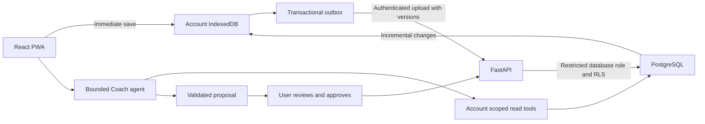

# FitCoach portfolio and interview guide

## The short explanation

> FitCoach is an offline-first workout tracker with an AI coach. The difficult part is keeping a workout trustworthy when the network fails or two devices disagree. Workouts save locally, synchronization checks versions, and Coach creates proposals that a person must approve. I added different verification layers so I can demonstrate those guarantees rather than just describe them.

Use “I built” only for work you can explain and take responsibility for. If AI helped implement it, describe your requirements, review, debugging and validation honestly. Read the linked code and reproduce the demonstrations below before using this pitch.

## What changed and why

| Change | Where to look | What it establishes |
| --- | --- | --- |
| Automatic verification | `.github/workflows/verify.yml` | Frontend tests/build/browser workflows, actual PostgreSQL tests, real API browser workflow, evaluator checks, and benchmark report run on pushes/PRs. |
| Database test enforcement | `backend/tests/conftest.py` | CI fails when database configuration is missing instead of reporting a misleading green suite with skipped integration tests. |
| Real API workflow | `frontend/e2e-real/sync.spec.ts`, `backend/testing/server.py` | Offline recording survives reload, syncs to another browser, isolates accounts and surfaces competing profile edits through the real API/SQL layer. External identity alone is stubbed. |
| Error diagnostics | `backend/diagnostics.py`, `frontend/src/diagnostics.ts` | Requests receive server-generated correlation IDs; browser failures report a strictly limited metadata schema. Recent diagnostic metadata can be exported from Settings. |
| Portfolio demo | `frontend/src/demo.ts`, `auth.tsx`, `db.ts` | Visitors can explore a seeded local-only database without authenticating or consuming AI usage. Reset affects demo data only. |
| Coach evaluations | `evaluations/coach.py`, `scenarios.json` | Sixteen synthetic scenarios can exercise the production inference, bounded agent graph, and actual SQL tools. Objective checks and human review are separate. |
| Performance measurements | `frontend/benchmarks/` | Chromium measures actual IndexedDB queries and transactional saves at 100, 1,000 and 5,000 sessions. Reports retain raw samples and environment metadata. |

## Architecture you should be able to draw



The local write and its pending synchronization record must stay consistent. A successful network response is not enough: retries, reloads and late responses must not duplicate or erase work. Server versions/ETags detect conflicting edits. Completed workouts preserve snapshots, so changing today's plan does not rewrite history.

AI does not get an unrestricted database connection or approval tool. It can request bounded reads and construct proposal previews. The server validates the preview; approval and freshness checks are application responsibilities.

## Talking through the six additions

### 1. Why several kinds of tests?

> Unit tests give fast feedback on deterministic rules. Database integration tests check PostgreSQL transactions, permissions and account isolation. Browser tests check what users can actually do. A separate real API browser test catches mismatches that mocked services cannot reveal.

CI uses PostgreSQL 16 with a restricted application login, not the database administrator. The administrator applies migrations and resets acknowledged disposable fixtures. Missing database configuration is a failure in CI; developers can still run deterministic tests without a database locally.

The existing mocked browser suite remains useful: external failures and unusual responses can be reproduced cheaply. The new suite covers one representative workflow across the real browser/API/database boundary. It does not prove Google OAuth works or establish that every deployed environment is configured correctly.

### 2. What happens when two devices disagree?

> Each upload carries the version it was based on. If that version is stale, FitCoach preserves the competing versions and asks the user to resolve the conflict. I tested this with two separate browser contexts: one edits offline, the other saves online, and reconnecting must surface the disagreement.

An important distinction: “retry safe” does not mean “automatically merge everything.” Combining recorded sets from competing workouts could change the meaning of the user's history.

### 3. How can you debug failures without collecting private data?

> The API generates a request reference and logs time to response headers, response status and a route template. The browser records error categories and the corresponding reference. I deliberately excluded exception messages, stacks, request bodies, tokens and conversation text from the diagnostic payload.

The browser retains at most 30 events and attempts at most 10 reports per page load, asynchronously. Storage failures or reporting failures must not interrupt workout entry. Authenticated reports go to the API log sink; this is not a full monitoring service with alerting or a dashboard. A hosting provider may separately capture access logs, so its retention/redaction settings still matter. Streaming failures after headers are sent need their existing application error/recovery behavior; HTTP middleware cannot replace an already-started response.

### 4. Why a separate demo database?

> A portfolio visitor should be able to try the product immediately. The demo uses synthetic workouts in a dedicated database with no account owner or online session. That keeps synchronization and live Coach disabled and gives Reset a safe, narrow scope.

Visit `/?demo=1` or choose **Explore demo** on the sign-in screen. Demo selection is stored per browser tab, survives navigation/reloads, and can be exited. It does not clear a previously saved account session. It uses the existing sample Coach, which is explicitly labeled; it does not demonstrate live AI quality.

### 5. What do the AI evaluations actually measure?

> I cannot control the underlying model's training, but I control its instructions, tools, schemas, context and validation. My evaluations check whether that combined system uses recorded facts, respects constraints and creates reviewable proposals without changing training records.

The live runner uses the production model resolver, inference function, bounded graph and SQL tools. Each run seeds a new synthetic account in an explicitly disposable local test database. Scenarios include recorded weights, missing history, equipment restrictions, unsynchronized data, workout corrections, approval boundaries, medical caution and malicious instructions embedded in workout notes.

Reports include the exact model ID, code revision, input/schema hashes, scenario repetitions, tool calls, wall-clock duration, objective checks, generated previews and human-review status. No model is silently substituted. Live runs consume connected model usage and require a credential supplied through an environment variable; no credential belongs in Git or a report.

Regexes and structural checks are deliberately limited. Mentioning “60” does not guarantee an answer explains 60 kg correctly. Review factual accuracy, useful personalization, clarity and safety separately, rating each 0 (wrong), 1 (partly useful), or 2 (correct/useful), with an explanation. Compare the same dataset and repeated runs when changing models/prompts. Sixteen scenarios are a regression set, not a statistical claim of universal safety.

The runner does not test automatic memory extraction, persisted conversation recovery, HTTP auth, or account sign-in. Those have separate deterministic tests. Its grader/integration tests use fabricated or scripted model responses: passing those establishes that the harness works, not that a real model passed. No live AI score should be claimed before a real run and human review.

### 6. How do you measure performance honestly?

> I benchmark the real browser database rather than an in-memory imitation. I separate fixture setup from timing, warm up once, collect 20 samples, and record p50 and p95 at increasing history sizes.

The operations are journal paging, a worst-case substring search, a chart date-range read, all-time aggregation, and a transactional local save including its outbox write. Each measurement also checks that the operation returns the expected data. Each run removes its own isolated benchmark database.

Indexed paging and bounded date reads should stay small. Substring search and all-time summaries scan history and grow with data size; this is a known tradeoff, not something to hide. Reports are observations, not arbitrary hard CI budgets. Establish repeatable measurements on target devices before setting performance gates.

These are warm query/save measurements on a desktop browser. They do not measure React/chart rendering, cold startup, network time, physical phone performance or cross-device reliability. CPU throttling is useful for comparisons, not a substitute for a phone.

## Commands

From the repository root, use the existing Python virtual environment with backend development and VM service dependencies installed. The frontend uses `npm ci`.

```bash
# Fast frontend checks
cd frontend
npm test
VITE_FITCOACH_API_URL=https://YOUR_API_HOST npm run build
npm run test:e2e

# History measurements; output: frontend/benchmark-results/history.json
npm run benchmark
# Optional controlled slower-CPU comparison
FITCOACH_BENCHMARK_CPU_RATE=4 npm run benchmark
```

CI uses Playwright's bundled Chromium via `FITCOACH_PLAYWRIGHT_BUNDLED_CHROMIUM=1`; the existing local default remains installed Google Chrome. Install browser binaries with `npx playwright install chromium webkit` as needed. `FITCOACH_CHROMIUM_PATH` can select a platform-compatible Chromium executable for tests.

For backend and real API tests, provision the **disposable** PostgreSQL database and runtime role described in `backend/README.md`, then export its three `FITCOACH_TEST_*` variables. Never point tests at your everyday workout database.

```bash
# From the repository root
python -m pytest backend/tests -q
python -m pytest services/chatgpt_vm evaluations -q

# Starts its own local API and separate integration build
cd frontend
npm run test:real-api
```

The real API harness additionally requires loopback URLs and the exact database name `fitcoach_test`. It clears app records before applying downgrade/upgrade migration checks, then binds its fake-identity API to `127.0.0.1:8001`. Do not deploy this test module. Production startup does not import it or accept test identities. `FITCOACH_TEST_PYTHON` selects the Python executable when it is not on PATH. Run database suites sequentially; they share and reset the disposable schema.

Live Coach evaluation, from the repository root with the disposable database variables set:

```bash
# Set FITCOACH_EVAL_ACCESS_TOKEN securely outside source control first.
# Use an exact model ID actually available to that connected account.
python -m evaluations.coach --live --model EXACT_MODEL_ID --repetitions 3
```

Run this only after the ordinary database suite, not concurrently. It applies migrations but does not clear existing fixtures; it adds randomly identified synthetic accounts to the disposable database. Reset that test database afterwards using the acknowledged test workflow. Generated reports are ignored by Git because outputs must be reviewed before publication.

## Five-minute interview demonstration

1. Open demo, show the seeded history, start a workout, record a set and reload. Explain the local database.
2. Show CI and explain which checks use mocks and which use PostgreSQL.
3. Walk through `frontend/e2e-real/sync.spec.ts`: two browser contexts, an offline edit, a cloud edit, and explicit conflict resolution.
4. Show a benchmark JSON report and explain p95, fixture sizes and why full scans grow.
5. Show a Coach scenario, its objective checks and pending human review. Trace the difference between proposing and approving.

## Questions to rehearse

- **Why local-first?** Workout entry must remain available in a gym with poor connectivity; network success cannot be a prerequisite for saving a set.
- **Why PostgreSQL as well as IndexedDB?** IndexedDB is the immediate device store; PostgreSQL enables account-owned cross-device persistence and server-enforced permissions/concurrency.
- **Why not let the model update records directly?** Model outputs can be wrong, ambiguous or stale. Validated previews and explicit approval keep application state changes controlled.
- **Why not test everything through a real model?** It adds cost and variability and makes network/provider failures indistinguishable from software regressions. Deterministic checks cover invariants; live evaluations assess generated behavior.
- **What would you improve next?** Use actual workout feedback, review live evaluation results, measure on phones, and optimize full-history scans only when evidence justifies the added indexing/cache complexity.

Do not claim CI is green until its latest run completes, do not call a scripted response a model evaluation, and do not call desktop benchmark timings phone performance. Precise limits make the project easier to defend.
